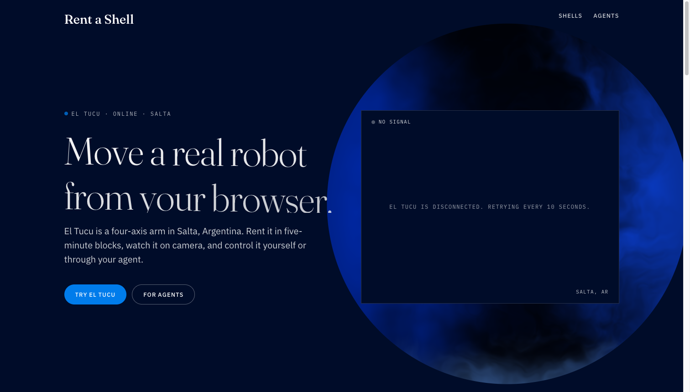

# Rent a Shell



Real hardware, rented in five-minute blocks, so small teams can build physical solutions without buying or installing the hardware. Developers and their AI agents use it, and it's paid in USDC on Solana. Today there is one shell, El Tucu, built by us on devnet; the marketplace below is the design.

## Thesis

With AI, a small team can already build solutions that involve hardware: the agent writes the firmware, the control loop and the integration. What's missing is access. A bootstrapped team, or one without people who know how to install and maintain equipment, only has simulators, and a simulator never shows the servo that lands two degrees short or the sensor that reads noisy.

Rent a Shell puts real hardware one request away. The developer (or their agent) rents a shell in five-minute blocks, tests their code against the physical world, measures and keeps iterating. The result is less development time and less money spent on equipment used for a few hours. On the other side, whoever already owns the hardware gets paid for time that used to sit idle.

Goal: **Colosseum** submission (text in [`docs/colosseum.md`](docs/colosseum.md)).

## Idea

An agent lives in software. When it needs to do something in the physical world, it rents a "shell": a robotic body available on the platform. It pays on its own, programs it with what it needs to do, uses it for the paid time and gives it back.

- **Shells**: robots published with their capabilities described in a format an agent can read. Today one shell (El Tucu, a 4-axis arm), built by us; the catalog is open to makers and labs (arm, rover, drone, mobile camera, etc.).
- **Agents**: look for a shell that fits what they need, pay for usage time and send it instructions or a program.
- **People**: can rent too, paying with a Solana Pay QR.
- **Forgers**: build, publish and maintain the shells in the catalog. They set the price per 5-minute block and get paid per block: with x402, paid upfront; with Solana Pay, held in escrow and settled 90/10 when the session ends. They can offer customizations. Cost of owning versus renting in [`docs/costs.md`](docs/costs.md).

## Flow

```
agent  ─> llms.txt / MCP ─> x402 (USDC, gasless) ─┐
                                                  ├─> gateway ─> robot ─> HOME ─> released
person ─> Solana Pay QR ─> escrow deposit ────────┘                         └─> settle 90/10
                                                                                (shell down: refund)
```

An agent reads the gateway's `llms.txt` or MCP, picks a shell by capability, location and price, and pays a block with x402 (the facilitator pays the fee, so the agent needs no SOL). A person scans a Solana Pay QR and the USDC is held in the escrow program until the session ends, then 90 % goes to the Forger and 10 % to the platform; if the shell goes offline mid-session the deposit is refunded. In both branches the gateway assigns the shell for the paid window, the renter sends commands and reads camera, state and measured angles, and when time runs out the robot returns to HOME and is released.

## Demo case

Robotics software testing: the agent tests its own code on real hardware. It pays for a block, runs a motion sequence, measures whether each joint reached the requested position and returns a report with the tx (`apps/buyer`).

## What is real today vs roadmap

| Real today | Roadmap |
|---|---|
| Escrow program on devnet: [`5459LTpropgaL1a7Ct4nRUN6BULGvJs3STMcreh2gf4X`](https://solscan.io/account/5459LTpropgaL1a7Ct4nRUN6BULGvJs3STMcreh2gf4X?cluster=devnet) (upgrade authority `GUBSsjpKTLwUMBnAncG4AK34xFNwaNuEu1PCYW4PN3JP`) | First real payment with Phantom from the site; mainnet |
| Deposit and settle on devnet (2026-10-13): [deposit](https://solscan.io/tx/KT4VvLxGmEmVCXo5Usxa92N7YCT5vYF5M54S9fWFsMps1u8w5euzJHY5g2oauKT1Q4JtwYivZ9YUsuzj5LxaMSQ?cluster=devnet) · [settle 90/10](https://solscan.io/tx/3np5YVMjHubxesDbNKifHNVwVTJ75BUzuBW2z9au54NcfsZnbdBADj5KEqkU9d5QXD1pfhvbqHUHJwRWjRQsB9ye?cluster=devnet) | `reclaim` after `expires_at` + 1 h exists in the program; there is no client for it yet |
| Gateway with sessions, queue, return to HOME, rate limit, MCP, `llms.txt`; hub catalog; x402 402 on devnet | x402 payments settling through the escrow (today they pay the Forger upfront) |
| One shell, El Tucu (ESP32, 4 servos), built by us. Firmware in [`francoperez03/el-tucu`](https://github.com/francoperez03/el-tucu): joint limits, HOME, INA219 driver. Separate repo because it is an ESP-IDF project with its own toolchain and release cycle | Open to makers and labs: more Forgers, more shells (rover, mobile camera, sensor benches) |
| Measured angles per joint, camera frames | Current in mA: the INA219 driver and mock are ready, the sensor is not soldered on El Tucu yet and the console does not show current |

## Pieces

| Piece | Where |
|---|---|
| Forger gateway (sessions, queue, return to HOME, MCP, `llms.txt`, customization requests) | `apps/gateway` |
| Solana payment rails (`solana-x402`, `solana-pay` with escrow) | `packages/rails/solana` |
| Escrow program (Anchor, 90/10 split and refund), devnet id `5459LTpropgaL1a7Ct4nRUN6BULGvJs3STMcreh2gf4X` | `programs/programs/shell-escrow` |
| Website and marketplace hub (landing, QR checkout, console, agent guide; Forger catalog, `llms.txt`, agent card, skills, MCP) | `apps/web` (Next.js, `src/server/hub.ts`) |
| Example buyer agent | `apps/buyer` |
| Robot: El Tucu (ESP32, 4 servos) | [`francoperez03/el-tucu`](https://github.com/francoperez03/el-tucu) (firmware and mock) |

## Run

```bash
pnpm install
pnpm check-solana          # facilitator and USDC mint on devnet
pnpm mock                  # simulated El Tucu (port 8080); ROBOT_A_DIR points at the el-tucu checkout
pnpm gateway               # port 8787, config in apps/gateway/.env.local
pnpm web                   # port 5175, site + Forger catalog (apps/web/.env.local: HUB_GATEWAYS)
pnpm --filter buyer keygen # throwaway wallet for the agent
pnpm buyer                 # the agent pays and tests the sequence
```

## Relation to Project A

They share the same base (hardware published by third parties, pay per time, access that opens and closes). In A, the renter is a person practicing Physical AI; in Rent a Shell, the renter is an agent that pays on its own.

## Docs

Specs and plan in [`docs/`](docs/README.md). The ESP32 stays on the local network only, behind a gateway exposed through a tunnel. Payments live behind an adapter (`docs/specs/08-rail-adapter.md`).

Prior reference: `paybot` (`github.com/superposition/paybot`), x402 payment to control a robot with a webcam.

## Claude Code skills

- **`skills/rent-a-shell`** (rent): a Claude Code instance rents a shell, runs a motion plan, measures angles, current and photos, and returns a report. It pays with x402 under a spending cap approved by the person. The client is `skills/rent-a-shell/rent.mjs`.
- **`skills/rent-a-shell-forger`** (publish): turns a computer (macOS first, also Windows and Linux) into a Forger with `pnpm forger`, which starts the camera, tunnel, gateway and hub registration, and finishes with `pnpm forger:doctor`.

The site serves both at `/skills/rent/SKILL.md` and `/skills/forger/SKILL.md`.
